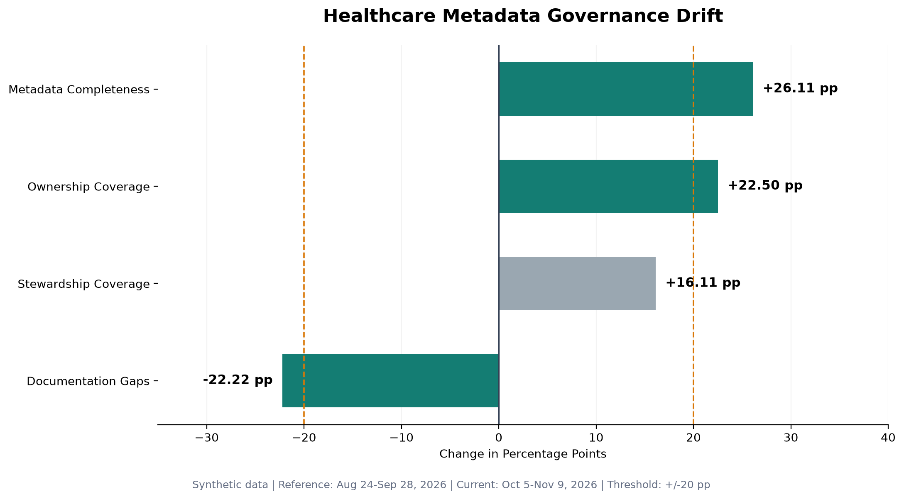

# cintel-05-drift-detection

[](pyproject.toml)
[](https://github.com/ssowers2/cintel-05-drift-detection/actions/workflows/ci-python-zensical.yml)
[](https://ssowers2.github.io/cintel-05-drift-detection/)

[](https://docs.astral.sh/uv/)
[](https://docs.astral.sh/ty/)
[](https://zensical.org/)
[](LICENSE)

> Detecting meaningful changes in healthcare metadata quality and governance readiness using Python, Polars, and drift detection techniques.

## Project Overview

**Author:** Sabriya Sowers
**Date:** November 2026
**Course:** Continuous Intelligence – Project 05

This project introduces drift detection by comparing current measurements against historical reference data to identify changes that exceed defined thresholds.

This project extends the **Metadata Completeness & Governance Readiness Monitor** developed in previous Continuous Intelligence assignments.

Project 03 introduced data governance metrics and signals. Project 04 expanded the project with weekly monitoring, rolling averages, and an interactive dashboard.

Project 05 builds on that work by applying drift detection to identify meaningful changes in metadata completeness, ownership coverage, stewardship coverage, and documentation gaps.

The project uses synthetic healthcare metadata and does not contain actual patient information.

Project configuration is maintained in [pyproject.toml](pyproject.toml).

## Project Progression

| Project | Focus | Governance Application |
|---|---|---|
| Project 03 | Signals and feature engineering | Established metadata quality and governance metrics |
| Project 04 | Rolling monitoring | Tracked governance metrics over time using rolling averages and an interactive dashboard |
| Project 05 | Drift detection | Compared historical and current governance metrics to identify changes exceeding defined thresholds |

**Previous project:** [Project 04 – Rolling Monitoring](https://github.com/ssowers2/cintel-04-rolling-monitoring)

**Previous dashboard:** [Governance Monitoring Dashboard](https://ssowers2.github.io/cintel-04-rolling-monitoring/governance/)

## Data

### Instructor's Example Data

The original example uses two datasets from the `data/` directory:

- **Reference data:** Measurements representing earlier system behavior.
- **Current data:** Measurements representing more recent system behavior.

Both datasets contain:

- `requests` – number of requests handled.
- `errors` – number of failed requests.
- `total_latency_ms` – total response time in milliseconds.

### Custom Governance Data

The governance customization uses synthetic healthcare metadata
carried forward from Project 04.

The primary dataset, `data/governance_metrics_timeseries.csv`,
contains 12 weekly observations.

A supporting asset-level dataset,
`data/governance_inventory_timeseries.csv`,
contains records for 60 synthetic data assets across the same
12-week period.

The monitored metrics include:

- **Metadata completeness:** Percentage of required metadata fields populated.
- **Data ownership coverage:** Percentage of assets with assigned data owners.
- **Stewardship coverage:** Percentage of assets with assigned data stewards.
- **Documentation gaps:** Percentage of metadata documentation that is missing or incomplete.

The first six weeks establish the reference period, and the
final six weeks represent the current period.

See the [Governance Data Card](docs/data-card.md) for additional
information about the datasets and their limitations.

## Approach

### Instructor's Example

The example pipeline uses Polars to:

1. Calculate summary statistics for reference and current data.
2. Calculate differences between the two periods.
3. Compare the differences against defined thresholds.
4. Flag measurements that indicate possible drift.
5. Save the results as CSV artifacts.

### Governance Customization

The custom pipeline applies the same drift detection techniques
used in the instructor's example:

1. Load the synthetic governance metrics using Polars.
2. Divide the 12 weekly observations into reference and current periods.
3. Calculate the average of each metric for both periods.
4. Calculate the difference between the averages.
5. Apply an illustrative threshold of 20 percentage points.
6. Flag changes exceeding the threshold.
7. Export the governance drift summary to CSV.
8. Generate a visualization of the results.

Drift is flagged when the absolute difference exceeds the
configured threshold.

The drift flags identify meaningful changes under the selected
criteria, not necessarily negative outcomes. Interpretation
considers whether each change represents an improvement,
decline, or area requiring further investigation.

## Project Components

- [pyproject.toml](pyproject.toml) – project configuration and dependencies.
- [src/cintel/drift_detector.py](src/cintel/drift_detector.py) – example drift detection pipeline.
- [src/cintel/app.py](src/cintel/app.py) – reactive Marimo application.
- [data/](data/) – reference and current measurements.
- [artifacts/](artifacts/) – generated comparisons and results.
- [tests/](tests/) – automated tests.
- [.github/workflows/](.github/workflows/) – automated checks and documentation deployment.
- [docs/](docs/) – project documentation.

### Governance-Specific Components

- [src/cintel/governance_drift_detector.py](src/cintel/governance_drift_detector.py) – governance drift detection pipeline.
- [src/cintel/governance_visualization.py](src/cintel/governance_visualization.py) – governance drift visualization script.
- [data/governance_metrics_timeseries.csv](data/governance_metrics_timeseries.csv) – weekly governance metrics.
- [data/governance_inventory_timeseries.csv](data/governance_inventory_timeseries.csv) – supporting asset-level observations.
- [artifacts/governance_drift_summary.csv](artifacts/governance_drift_summary.csv) – governance drift results.
- [artifacts/governance_drift_chart.png](artifacts/governance_drift_chart.png) – generated visualization.
- [docs/data-card.md](docs/data-card.md) – governance dataset documentation.

## Run the Project

Follow the [Professional Python Workflow Guide](https://denisecase.github.io/pro-analytics-02/) to set up the project environment.

From the VS Code terminal in the project root:

```shell
uv run python -m cintel.drift_detector
```

## Run the Reactive App

From the VS Code terminal in the project root:

```shell
uv run marimo run src/cintel/app.py
```

Press `CTRL + C` to stop the application.

## Results

The instructor's example pipeline produces:

- `artifacts/drift_summary.csv` – summary comparisons and drift flags.
- `artifacts/drift_summary_long.csv` – comparison results in a longer format.
- `artifacts/drift_stats.csv` – statistical comparison of error rates.

The pipeline also creates a `project.log` file.

Successful execution produces:

```text
========================
Pipeline executed successfully!
========================
```

### Technical Modification: Requests Drift Threshold

A controlled experiment was completed by increasing the requests drift threshold from `20.0` to `40.0` in `src/cintel/drift_detector.py`.

The original pipeline flagged requests, errors, and latency as drifting. After the modification:

| Metric | Original Drift Flag | Modified Drift Flag |
|---|---|---|
| Requests | True | False |
| Errors | True | True |
| Latency | True | True |

The experiment confirmed that increasing a drift threshold reduces detection sensitivity without changing the underlying measurements.

See the [Project Documentation](https://ssowers2.github.io/cintel-05-drift-detection/) for the prediction, verification, and results.

### Governance Drift Detection — Custom Application

The Project 05 customization applies drift detection to synthetic
healthcare metadata governance metrics carried forward from Project 04.

The pipeline compares the first six weeks of observations against
the final six weeks using average values and illustrative thresholds
of 20 percentage points.

#### Governance Results

| Governance Metric | Change (pp) | Drift Flag |
|---|---:|---|
| Metadata completeness | +26.11 | True |
| Ownership coverage | +22.50 | True |
| Stewardship coverage | +16.11 | False |
| Documentation gaps | -22.22 | True |

Three of the four governance metrics exceeded the drift threshold.

All four metrics improved. Increases in completeness, ownership,
and stewardship coverage represent positive changes, while a
decrease in documentation gaps represents improved documentation.

Drift indicates a meaningful change under the selected threshold,
not necessarily a negative outcome.

#### Governance Visualization



#### Run the Governance Pipeline

```powershell
python -m cintel.governance_drift_detector
```

#### Generate the Visualization

```powershell
python -m cintel.governance_visualization
```

#### Generated Artifacts

- `artifacts/governance_drift_summary.csv`
- `artifacts/governance_drift_chart.png`

See the [Project Documentation](https://ssowers2.github.io/cintel-05-drift-detection/)
for detailed methodology, results, and interpretation.

## Verification

Run automated tests:

```shell
uv run pytest
```

### Verification Results

The final project verification was completed successfully.

- **Automated tests:** 1 passed.
- **Total test coverage:** 37%.
- **Required coverage:** 20% (met).
- **Documentation build:** Successful; no issues found.
- **Governance drift pipeline:** Executed successfully.
- **Governance visualization:** Generated successfully.

The existing automated test suite does not directly cover the
governance drift detector or visualization scripts. These
components were verified through successful execution and
review of the generated results.

Additional automated tests could be developed to validate
governance-specific calculations and drift thresholds.

## Project Documentation

The [hosted documentation site](https://ssowers2.github.io/cintel-05-drift-detection/) is published using Zensical and GitHub Pages.

The project documentation includes the instructor's example,
the controlled threshold experiment, and the governance
customization.

The governance report documents the datasets, methods,
drift results, visualization, interpretation, and limitations.

Project 05 demonstrates how drift detection extends the
rolling governance monitoring developed in Project 04.

## CI/CD and GitHub Actions

This project includes continuous integration and continuous deployment (CI/CD) to check project files and publish documentation.

GitHub Actions include:

- [CI: Python and Documentation Checks](https://github.com/ssowers2/cintel-05-drift-detection/actions/workflows/ci-python-zensical.yml)
- [CD: Documentation Deployment](https://github.com/ssowers2/cintel-05-drift-detection/actions/workflows/deploy-zensical.yml)

## Developer Reference

Follow the [Professional Python Workflow Guide](https://denisecase.github.io/pro-analytics-02/) for detailed instructions and troubleshooting.

### Initialize and Update the Python Environment

From the VS Code terminal:

```shell
uvx pup-clean --delete
uv self update
uv python pin 3.14
uv python install
uv lock --upgrade
uv sync
uv audit
```

### Set Up and Run Git Hooks

```shell
uvx prek install --force
uvx prek update --freeze --cooldown-days 7

git add -A
uvx prek run --all-files

# Repeat if changes were made
uvx prek run --all-files
```

### Run Common Chores

Run linters, formatters, type checks, tests, and build documentation.

```shell
uv run ruff check . --fix
uv run ruff format .

uv run ty check
uv run python -m pytest
uv run python -m zensical build
```

### Git Add, Commit, and Push

```shell
git add -A
git commit -m "describe your changes in quotes"
git push -u origin main
```

## Developer Notes

- Use the **UP ARROW** and **DOWN ARROW** in the terminal to scroll through previous commands.
- Use `CTRL + F` to find text within a file.
- Review generated artifacts and test results before committing changes.

## Developer Tools

This project uses professional Python tools for development, testing, documentation, and code quality.

- [uv](https://docs.astral.sh/uv/) – Python environments and dependencies.
- [Ruff](https://docs.astral.sh/ruff/) – Python linting and formatting, configured in [.ruff.toml](.ruff.toml).Remove-Item -Recurse -Force site\app -ErrorAction SilentlyContinue
- [ty](https://docs.astral.sh/ty/) – Python type checking.
- [pytest](https://docs.pytest.org/) – automated Python testing, configured in [.pytest.toml](.pytest.toml).
- [prek](https://prek.j178.dev/) – Git hooks and automated checks, configured in [prek.toml](prek.toml).
- [Zensical](https://zensical.org/) – project documentation, configured in [zensical.toml](zensical.toml).
- [Polars](https://pola.rs/) – DataFrame processing and analysis.
- [Marimo](https://marimo.io/) – reactive Python applications.
- [Matplotlib](https://matplotlib.org/) – governance drift visualization.
- [Plotly](https://plotly.com/python/) – interactive governance drift visualization in the Marimo application.

## Links

- [GitHub Repository](https://github.com/ssowers2/cintel-05-drift-detection)
- [Hosted Documentation](https://ssowers2.github.io/cintel-05-drift-detection/)
- [Project 04 Repository](https://github.com/ssowers2/cintel-04-rolling-monitoring)
- [Project 04 Governance Dashboard](https://ssowers2.github.io/cintel-04-rolling-monitoring/governance/)
- [Instructor's Project 05 Example](https://github.com/denisecase/cintel-05-drift-detection)
- [Professional Python Workflow Guide](https://denisecase.github.io/pro-analytics-02/)
- [Citation](CITATION.cff)
- [License](LICENSE)
