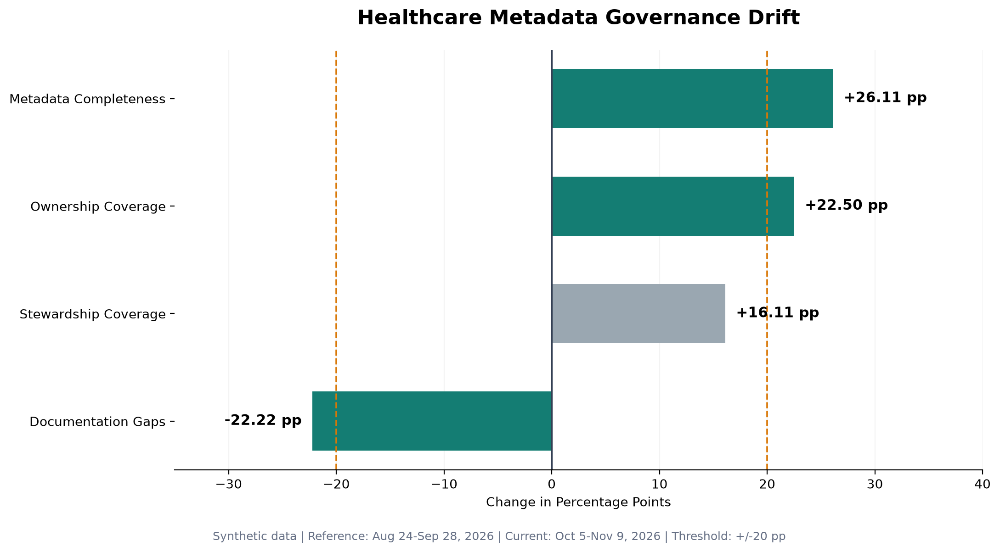

# Detecting Changes in System Behavior

Continuous Intelligence | Project 05 | Example Report

## Overview

This project examines whether recent system behavior
differs meaningfully from an earlier reference period.

The objective is to detect changes in operational metrics
that may indicate a need for investigation.

## Data

Two datasets represent different observation periods:

- Reference data representing earlier behavior.
- Current data representing more recent behavior.

Each contains measurements of requests,
errors, and total latency.

[View Data](https://github.com/ssowers2/cintel-05-drift-detection/tree/main/data)

## Methods

The pipeline calculates the mean of each metric
for both observation periods.

It then calculates:

    difference = current_mean - reference_mean

Drift is flagged when the absolute difference
exceeds the configured threshold.

The original example uses the following thresholds:

- Requests: 20.
- Errors: 2.
- Total latency: 1,000 milliseconds.

These thresholds are illustrative and should
be justified for a production monitoring system.

## Results

The original example compared historical and current system metrics. All three metrics were initially flagged as drifting.

| Metric | Reference Mean | Current Mean | Difference | Modified Threshold | Drift Flag |
|---|---:|---:|---:|---:|---|
| Requests | 128.3 | 164.5 | +36.2 | 40.0 | False |
| Errors | 2.3 | 6.3 | +4.0 | 2.0 | True |
| Total latency (ms) | 3,835 | 5,670 | +1,835 | 1,000 | True |

After increasing the requests drift threshold from 20.0 to 40.0, requests were no longer flagged as drifting. Errors and latency remained flagged because their differences still exceeded the configured thresholds.

[View Drift Results](https://github.com/ssowers2/cintel-05-drift-detection/tree/main/artifacts)

[View Detailed Summary](https://github.com/ssowers2/cintel-05-drift-detection/tree/main/artifacts)

## Custom Modifications

### Adjusting the Requests Drift Threshold

**Change:** Updated `REQUESTS_DRIFT_THRESHOLD` from `20.0` to `40.0` in `src/cintel/drift_detector.py`.

**Reason:** To evaluate how increasing a drift threshold affects which metrics are flagged as drifting.

**Prediction:** If the requests drift threshold increases from 20.0 to 40.0, requests will no longer be flagged as drifting because the observed difference of 36.2 is below the new threshold.

**Verification:** Used `git status` and `git diff` to confirm that only the requests threshold was changed.

**Results:** The prediction was confirmed. The requests drift flag changed from `True` to `False`, while the errors and latency drift flags remained `True`. The pipeline executed successfully.

**Conclusion:** Increasing the threshold made drift detection less sensitive to changes in request volume without affecting the underlying measurements.

## Governance Drift Detection — Custom Application

### Problem

This customization applies drift detection to synthetic healthcare
metadata governance measurements rather than system performance metrics.

The objective is to identify meaningful changes in metadata completeness,
data ownership coverage, stewardship coverage, and documentation gaps.

### Data

The data was carried forward from Project 04: Rolling Monitoring.

The primary dataset is `data/governance_metrics_timeseries.csv`,
which contains 12 weekly observations.

Supporting asset-level records are available in
`data/governance_inventory_timeseries.csv`.

See the [Governance Data Card](data-card.md) for additional details.

### Techniques Applied

The governance pipeline applies the same techniques demonstrated
in the instructor's example:

1. Load data using Polars.
2. Establish reference and current observation periods.
3. Calculate the average of each metric for both periods.
4. Calculate the difference between the averages.
5. Apply drift thresholds.
6. Save the results as a CSV artifact.

### Methods and Settings

The 12 weekly observations were divided into two periods:

- Reference: August 24–September 28, 2026 (6 weeks).
- Current: October 5–November 9, 2026 (6 weeks).

Drift was evaluated using the absolute difference between period averages.

An illustrative threshold of 20 percentage points was selected
for all four governance metrics.

This threshold is used to demonstrate the detection method
and is not an established healthcare governance standard.

### Governance Drift Results

| Governance Metric | Reference Mean | Current Mean | Change (pp) | Drift Flag |
|---|---:|---:|---:|---|
| Metadata completeness | 25.28% | 51.39% | +26.11 | True |
| Ownership coverage | 65.28% | 87.78% | +22.50 | True |
| Stewardship coverage | 49.72% | 65.83% | +16.11 | False |
| Documentation gaps | 64.72% | 42.50% | -22.22 | True |

Three of the four governance metrics exceeded the selected threshold.

All four metrics moved in a favorable direction. Completeness,
ownership, and stewardship coverage increased, while documentation
gaps decreased.

Drift flags indicate changes requiring interpretation rather than
automatically identifying problems.

### Governance Drift Visualization

The following chart compares changes in governance metrics between
the historical reference period and the current monitoring period.

The chart displays changes in percentage points.

- Teal bars indicate changes that exceeded the drift threshold.
- Gray bars indicate changes that did not exceed the threshold.
- Orange dashed lines represent the illustrative thresholds of
  -20 and +20 percentage points.
- Negative values represent decreases, while positive values
  represent increases.

### Interpretation of Governance Results

All four governance metrics improved between the reference and
current periods.

Metadata completeness increased by 26.11 percentage points,
and ownership coverage increased by 22.50 percentage points.
Both exceeded the selected drift threshold.

Stewardship coverage increased by 16.11 percentage points but
did not exceed the threshold.

Documentation gaps decreased by 22.22 percentage points,
representing an improvement in documentation coverage.

Three of the four metrics were flagged as drifting.

These results demonstrate that drift is not necessarily negative.
Drift detection identifies changes that exceed a defined threshold,
while interpretation determines whether those changes represent
improvements, declines, or areas requiring investigation.

The results are based on synthetic data and do not represent
actual healthcare organizational performance.

### Governance Analysis Limitations

The analysis uses 12 weeks of synthetic data divided into two
six-week periods. The small number of observations limits the
ability to identify longer-term trends or seasonal patterns.

The 20-percentage-point threshold is illustrative and has not
been validated against organizational requirements.

Comparing averages may also hide weekly fluctuations or
changes in the underlying inventory.

The results demonstrate the drift detection technique but
should not be interpreted as evidence of actual organizational
performance.

### Governance Pipeline and Artifacts

- [Governance Drift Detection Script](https://github.com/ssowers2/cintel-05-drift-detection/blob/main/src/cintel/governance_drift_detector.py)
- [Governance Drift Summary](https://github.com/ssowers2/cintel-05-drift-detection/blob/main/artifacts/governance_drift_summary.csv)
- [Governance Drift Visualization](https://github.com/ssowers2/cintel-05-drift-detection/blob/main/artifacts/governance_drift_chart.png)
- [Governance Data Card](data-card.md)
- [Governance Visualization Script](https://github.com/ssowers2/cintel-05-drift-detection/blob/main/src/cintel/governance_visualization.py)

## Original Example — Interpretation

The current period shows higher average request volume,
higher average errors, and greater total latency.

These changes suggest that the system is operating
differently from its reference behavior.

An analyst could investigate whether the changes
reflect increased workload, changing demand,
or a potential performance problem.

Although request volume increased, the modified threshold no
longer flags it as drifting. This demonstrates how threshold selection
influences which changes are identified for further investigation.

## Original Example — Limitations

The approach compares means using fixed thresholds.

It does not account for variability,
statistical significance, or seasonal patterns.

Higher request volume may also explain part
of the increase in errors and total latency.

Additional normalized signals, such as error rate
and average latency per request, would help
distinguish workload changes from degraded performance.

## Original Example — Conclusion

Baseline comparisons provide a practical starting point
for detecting changes in operational behavior.

Drift indicators are evidence for investigation,
not proof that a system is malfunctioning.

## Documentation Index

- **Home** - this landing page
- [**Project Instructions**](project-instructions.md)
- [**Glossary**](glossary.md)
- [**API**](api.md)
- [**Reactive App**](./app/index.html)
- [Governance Data Card](data-card.md)

## Project Links

- [GitHub Repository](https://github.com/ssowers2/cintel-05-drift-detection)
- [Example Pipeline](https://github.com/ssowers2/cintel-05-drift-detection/tree/main/src/cintel)
- [Results and Artifacts](https://github.com/ssowers2/cintel-05-drift-detection/tree/main/artifacts)

## Project Resources

- [Project Instructions](project-instructions.md)
- [Professional Python Guide](https://denisecase.github.io/pro-analytics-02/)
- [Professional Python Project Explainer](https://pup-pack.github.io/professional-python-project-explainer/).
- [Suggested Datasets](https://denisecase.github.io/pro-analytics-02/reference/datasets/cintel/)
